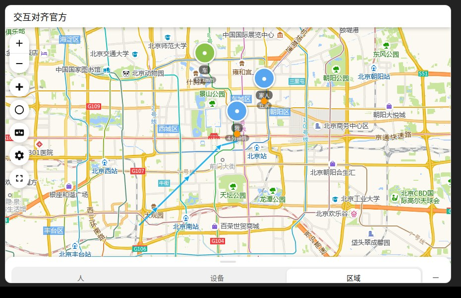
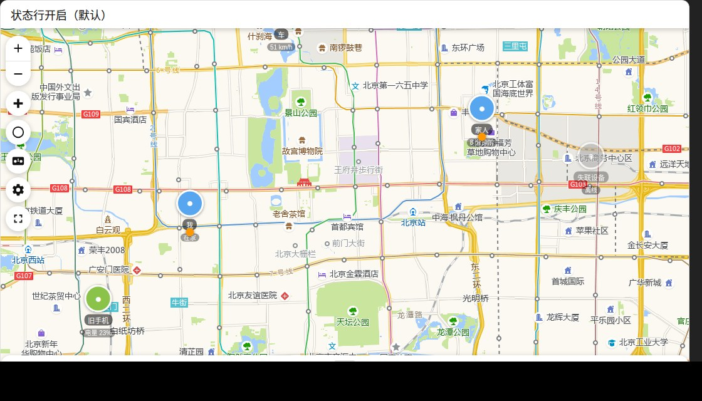
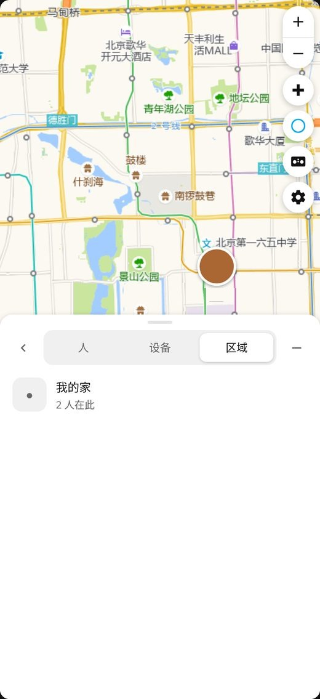
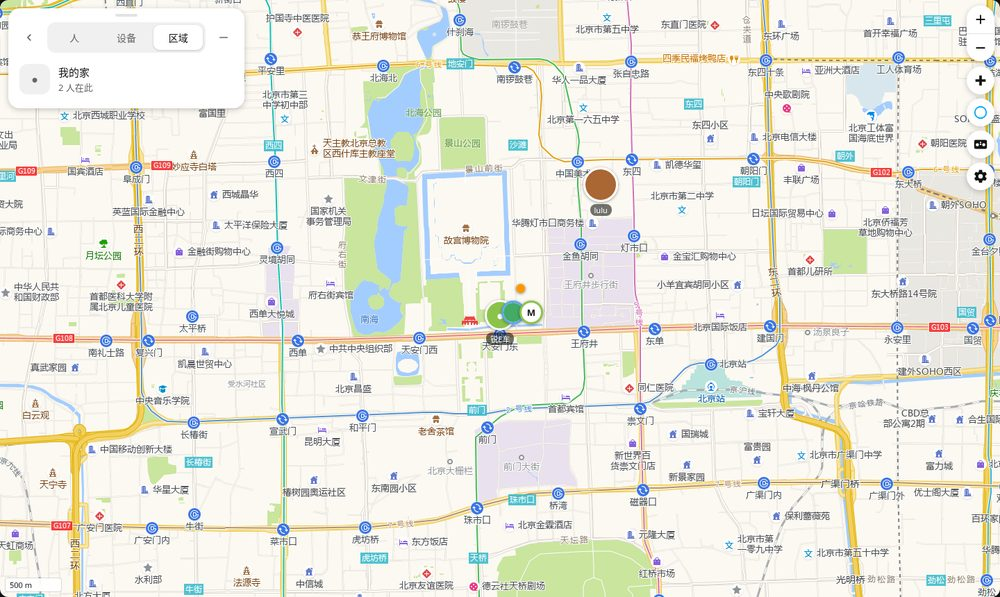
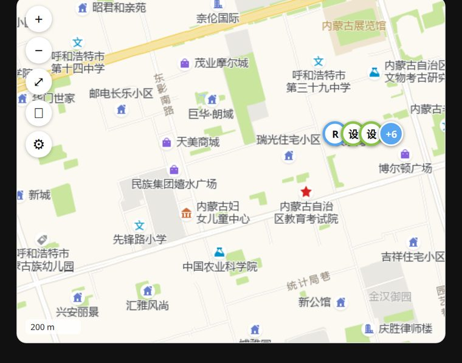

# ha-map-cn · 中国地图卡片

> Home Assistant 地图卡片，国内底图直连。
> **不改 HA 源码、不装代理、不需要服务器能翻墙**——瓦片由浏览器直接加载。
> 交互与布局对齐官方 `hui-map-card`：panel 视图自动铺满 + 底部/侧边概览面板。

[](https://hacs.xyz)

## 安装（HACS，资源自动添加）

1. HACS → 右上角 ⋮ → **自定义存储库**
2. 填 `https://github.com/RockJesus/ha-map-cn`，类别选 **Lovelace / Dashboard**
3. 搜索安装 → **重启 HA**（或刷新浏览器）
4. **资源会自动注册**，无需手动添加

> 安装包是仓库根的 `ha-cn-map-card.js`（`hacs.json` 声明 `filename`，`content_in_root: true`），esbuild 打包的单文件，开箱即装。
> 如果 HACS 版本较旧没自动加，手动加一条：`/hacsfiles/ha-map-cn/ha-cn-map-card.js`，类型 **JavaScript Module**。

### 更新后看不到新功能？

**HACS 安装（绝大多数人）：什么都不用做。** HACS ≥ 2.0 在每次升级后会自动把资源 URL 改写成
`?hacstag=<仓库ID><版本号>`（可在 设置 → 仪表盘 → 资源 里看到），版本一变 URL 就变，
浏览器缓存自动失效。手动改这条 URL 没有必要——下次升级 HACS 会照旧覆写。

**手动安装：** 浏览器会缓存旧 JS，升级后给资源 URL 加版本参数强制刷新：

```
/local/ha-cn-map-card.js?v=090
```

每升一版把 `090` 递增即可（如 `100`）。

### 手动安装（不用 HACS）

下载 `ha-cn-map-card.js`（发布产物已是自足的单文件）放到 `/config/www/`，资源里加 `/local/ha-cn-map-card.js`，类型选 **JavaScript Module**。

## 为什么需要它

HA 2026.9 起，官方地图改用 OSMF 矢量瓦片，且**瓦片请求由 HA 服务器发出**。国内服务器的出口访问不到 `vector.openstreetmap.org`，所以官方 `type: map` 卡片在全国范围都是纯色底——手机挂代理也没用，因为请求根本不经过手机。

这个卡片把底图换成**浏览器直连**的国内瓦片服务，绕开服务器出口问题。

| | 官方 `type: map` | 本卡片 |
|---|---|---|
| 底图来源 | OSMF 矢量瓦片 | 高德 / 天地图 |
| 请求发起方 | HA 服务器 | 你的浏览器 |
| 国内可用 | 否（除非服务器能翻墙） | **是** |
| 需要改 HA 源码 | — | 否 |
| 安装方式 | 内置 | HACS / 手动放一个 js |
| 标记偏移 | 无 | 高德自动 GCJ-02 纠偏 |

---


## 配置

### 图形界面（推荐）

在仪表盘编辑模式下点卡片的「编辑」，弹出的是**完整可视化编辑器**，无需写 YAML：

| 表单区域 | 可设置 |
|---|---|
| 标题 | 卡片顶部标题，留空则不显示标题栏 |
| 底图来源 | 高德 / 高德卫星 / 天地图 / 天地图卫星 / OSM（下拉选择） |
| 天地图 Key | **仅当选天地图时出现**，自动联动 |
| 显示哪些标记 | 自动显示全部 / 显示区域 / 标记聚合 / 标记状态行 / 首次自动缩放 |
| 指定实体 | 选 domain 过滤 → 下拉选实体 → 点「添加」；已添加的显示为标签可逐个删除。**关掉「自动显示全部」时才出现** |
| 默认缩放级别 | 关掉「首次自动缩放」时生效 |
| 卡片高度 | 像素值，改完预览实时变化 |

所有改动即时通过 `config-changed` 回传，点「保存」才落盘。

### YAML

最小可用：

```yaml
type: custom:ha-cn-map-card
show_all: true
```

完整字段：

```yaml
type: custom:ha-cn-map-card
title: 家人位置               # 可选，显示顶部标题栏
height: 400                  # 卡片高度（px），默认 360

basemap: amap                # amap(默认) | amap-satellite | tianditu | tianditu-satellite | osm
tianditu_key: ""             # 用天地图时必填

entities:                    # 指定实体；不填则配合 show_all
  - person.me
  - entity: device_tracker.car   # 对象形式：逐实体覆盖显示
    name: 家里那台
    color: "#e53935"
    label_mode: attribute
    attribute: battery_level
    unit: "%"
show_all: false              # true = 自动列出所有 person./device_tracker./geo_location.
show_zones: false            # true = 显示 zone.* 区域图标
show_status: true            # 标记下方状态行（在家 / 离线 / 速度 / 电量），默认开
show_accuracy: true          # 显示 gps_accuracy 精度圈（官方行为），默认开
geo_location_sources: []     # 按 source 过滤 geo_location 实体

layout: auto                 # auto(默认) | full | compact
fullscreen: true             # 等价 layout: full
show_cluster: true           # 标记聚合（默认开）；相近标记合并成气泡
show_labels: true            # 标记下方显示名称
persist: true                # 允许抽屉改动存到浏览器；false = 只在本次浏览有效
fit_entities: true           # 首次自动缩放到所有实体
default_zoom: 12             # fit_entities: false 时生效

hours_to_show: 0             # >0 时绘制轨迹线（0=关闭，24=最近24小时）
track_width: 3               # 轨迹线宽
track_opacity: 0.85          # 轨迹不透明度
show_traffic: false          # 高德实时路况叠加（仅 amap 底图）

# —— 外观（v1.0.x 新增）——
theme_mode: auto             # auto(跟随 HA 主题) | light | dark
label_mode: name             # name | state | attribute | none（可逐实体覆盖）
aspect_ratio: ""             # 如 "16:9"；填了忽略 height
show_zone_radius: true       # 按 zone.radius 画虚线半径圈
fit_zones: false             # 自动缩放时把半径圈算进视野
dedupe_trackers: true        # person 已覆盖的 device_tracker 不再单独画点
respect_hidden: true         # 跳过实体注册表里隐藏的实体（hidden_by 非空，v1.1.4）
```

> 完整字段以 `setConfig` 默认值为准（[源码](ha-cn-map-card.js)）；抽屉与可视化编辑器改过的选项会存在浏览器本地，优先于 YAML，`persist: false` 可关闭这一行为。

### 条件显示（conditions，v1.1.4）

和官方条件卡片同一语义：`conditions` 里每一条都满足才渲染这张卡，否则整张卡隐藏：

```yaml
conditions:
  - entity: binary_sensor.workday      # 状态匹配
    state: "on"
  - entity: person.zhangsan            # 状态不匹配
    state_not: "home"
  - entity: sensor.car_battery         # 属性匹配（attribute 指定取值来源）
    attribute: battery_level
    state: "80"
```

支持 `state` / `state_not` / `attribute` 三种字段；实体不存在视为不满足；`conditions` 缺省或为空数组时永远显示。只写 YAML，图形编辑器暂不提供这一项。

### geo_location 来源与逐实体写法（v1.1.5）

`entities` 对象条目新增三个字段：

```yaml
entities:
  - entity: sensor.car                # 数值标签加单位
    label_mode: attribute
    attribute: battery_level
    unit: "%"
  - source: nmap                      # 不写 entity：纳入该来源的全部 geo_location 实体
    label_mode: state
  - entity: person.zhangsan
    focus: true                       # 首帧渲染后把视野聚焦到它（URL 深链优先）
```

`source` 写法等价于全局 `geo_location_sources`，但可以只给这一路来源设置 `label_mode` / `name` / `color`。编辑器列表里 source 条目显示为「geo_location 来源：xxx」，可单独移除。

### 底图对比

| basemap | 需要 Key | 最大级别 | 偏移处理 | 说明 |
|---|---|---|---|---|
| `amap` | 否 | 18 | 自动 GCJ-02 纠偏 | **默认**，免申请，国内速度最快 |
| `amap-satellite` | 否 | 18 | 同上 | 高德卫星影像 + 路网标注 |
| `tianditu` | **是** | 18 | 无需（CGCS2000≈WGS84） | 国家天地图矢量 + 中文注记，合规性最好 |
| `tianditu-satellite` | **是** | 18 | 无需 | 天地图影像 + 注记 |
| `osm` | 否 | 19 | 无需 | 海外或能翻墙时用 |

天地图 Key 免费申请：<https://console.tianditu.gov.cn/> → 创建应用 → 选「浏览器端」→ 复制 tk。免费额度约 1 万次/天。

---

## 轨迹线

设置 `hours_to_show: 24`（或任意小时数）即可在地图上画出实体的历史轨迹：

- 通过 WebSocket `history/stream` 订阅，数据实时推送，不用反复轮询 REST
- 每个实体按颜色区分，颜色优先取卡片配置里的 `color`，其次实体属性，最后默认蓝
- 高德底图下轨迹点自动做 GCJ-02 纠偏，**和标记一样不会偏移**
- 轨迹超出视口时由 SVG 裁剪，不会画出跨省直线
- 沿线每 90px 画一个小三角**指示行进方向**，随平移/缩放实时重算，带白色描边不与轨迹线混淆
- 卡片从仪表盘移除时自动取消订阅，不留后台连接

> 前提：实体有历史记录。刚装的 HA 或刚接入的设备需要等一段时间才有数据。

## 交互（对齐官方 hui-map-card）



### 点击标记 = 聚焦，再点 = 详情

和官方一致，点击标记不再直接弹窗：

| 操作 | 行为 |
|---|---|
| 第一次点标记 | 地图**平滑飞到**该实体（已在视野内则只平移不缩放），标记加主题色光环，**面板切到该实体的「最近活动」** |
| 再点同一标记 | 打开 more-info 详情弹窗 |
| 点地图空白处 / 按 `Esc` | 取消选中，光环消失，详情退回列表 |
| 点概览列表项 | 同上：首次聚焦并看最近活动，再次打开详情 |

飞行时长 550ms，easeInOutQuad；**飞行途中用鼠标拖动或滚轮会立即接管**，不会和动画抢方向。
全屏且面板展开时，飞行落点会往面板对侧偏移，保证标记不被遮挡。

### 最近活动（对齐官方 overview 的 activity 时间线）

点标记/列表项后，面板显示该实体的详情头部（名字 + `状态 · 相对时间`）和**最近 24 小时活动**：

| 元素 | 规则 |
|---|---|
| 数据源 | WebSocket `history/history_during_period`（和官方 `fetchDateWS` 同一条消息） |
| 时间窗 | 最近 **24 小时** |
| 条目 | 只取**状态变化**，跳过 `unavailable` / `unknown`（掉线不算活动） |
| 排序 | 最新在上 |
| 条数 | 最多 **20** 条，默认显示 **5** 条，超出显示「显示全部 N 条」 |
| 每行 | 头像（`entity_picture` → 首字母）、状态文字（`在家` / `离家` / `在 公司`）、`HH:MM · 相对时间` |
| 选中区域 `zone.*` | 改为显示**人员进出记录**：`我 进入 · 21:03 · 5 小时前` |

没有历史数据（新装的 HA、集成未记录）时显示「最近 24 小时没有活动」；`history` 集成被禁用或查询失败时显示「活动记录不可用」。

### 键盘快捷键

地图获得焦点后（点一下地图即可）：

| 按键 | 行为 |
|---|---|
| `+` / `-` | 放大 / 缩小一级 |
| `方向键` | 平移（`Shift` + 方向键 = 大步） |
| `Esc` | 取消选中 |

### GPS 精度圈

实体带 `gps_accuracy`（米）时自动画一圈半透明范围，和官方的精度可视化一致：

- 半径按当前纬度实时换算成像素，缩放时跟着变
- 颜色跟随实体配色（`entities[].color` → 属性 `color` → 按域默认色）
- 高德底图下圆心与该实体标记一起做 GCJ-02 纠偏，不会和标记错位
- `zone.*` 不画；半径小于 2px 或大到超出视口 3 倍时自动跳过
- 关掉：设置抽屉关「GPS 精度圈」，或 YAML 写 `show_accuracy: false`

## 标记状态行

每个标记下方除了名称，还有一行**短状态**，一眼看出谁在哪、设备还有没有电：



| 实体状态 | 标记显示 |
|---|---|
| 在某个 `zone.*` 里 | 区域名，如 `在家` / `公司` |
| `home` | `在家` |
| `not_home` 且无速度 | `离家 · 4 分钟前` |
| 有 `speed` 属性 | `51 km/h`（属性为 mph 时显示 mph） |
| 有 `battery_level` 属性 | `电量 23%` |
| `unavailable` / `unknown` | `离线` + **整个头像灰显半透明** |

判定优先级：离线 > 区域名 > 速度 > 电量 > 离家 > 相对时间（`last_updated`，取不到时退回 `last_changed`）。区域类标记（家/公司图标）不显示状态行。

关掉：抽屉里取消「标记显示状态」，或 YAML 写 `show_status: false`。

## 实时路况

`show_traffic: true` 会在高德底图上叠加实时路况瓦片（红黄绿线），或点卡片左上角 🚦 一键开关。

- **仅支持 `amap` / `amap-satellite`**：路况瓦片和底图必须同一坐标系
- 天地图/OSM 下该按钮无效，避免错位

## 布局：自动全屏 / 占满仪表盘

把卡片放进 **panel 视图**（仪表盘 → 编辑 → 视图类型选「面板」），它会自动铺满整屏，
行为和官方地图卡片一致。

| 视图类型 | 卡片表现 |
|---|---|
| **panel（面板）** | 地图铺满整屏，右侧悬浮控件，左上角（手机为底部）概览面板 |
| sections / masonry / grid | 按 `height` 给固定高度，底部抽屉默认收起 |
| sections + `fill: true` | 地图脱离文档流铺满视口——**在 sections 视图里也能全屏**，不必改成面板视图 |
| 任意（`layout: full`） | 强制按全屏布局渲染 |
| 任意（点左下/左上 ⛶ 按钮） | 立刻全屏，再点或按 `Esc` 退出——**不改 YAML 也能全屏** |

| 手机（底部抽屉） | 桌面（左侧浮层） |
|---|---|
|  |  |

判定逻辑（v0.9.4 重写）：

1. 先看 **`hui-card` 给卡片元素赋的 `layout` 属性**——panel 视图里它会被设成 `"panel"`，
   这是官方 `hui-map-card` 用的同一个信号（比爬 DOM 可靠，因为卡片挂在 shadow root 里，
   往上的 `parentElement` 会直接断掉）；
2. 没有这个信号时，再**穿透 shadow root** 往上找 `hui-panel-view` / `hui-grid-section`；
3. 判定为全屏但**实测没占满视口**时（panel 视图不给高度、sections 格子只有 410px），
   自动升级为 `position:fixed` 真正铺满——不用你再手动补 `fill`。

想强制指定用 `layout`：

```yaml
type: custom:ha-cn-map-card
layout: full      # full=铺满 | compact=固定高度 | 不填=自动判断
```

**视图是 sections（网格）、卡片被困在固定高度格子里？** 三种办法任选：

```yaml
type: custom:ha-cn-map-card
fill: true        # 写法一：YAML 强制铺满（最稳）
```

- 写法二：点卡片上的 ⛶ 全屏按钮，`Esc` 或再点一次退出（无需改 YAML）
- 写法三：可视化编辑器里「显示模式」选「总是铺满全屏」

### 概览面板（对齐官方 hui-map-overview）

| 特性 | 说明 |
|---|---|
| 三个标签 | **人 / 设备 / 区域**，只显示有内容的标签 |
| 列表项 | 头像或首字母 + 名称 + 「在 某区域 · 4 分钟前」 |
| 点击列表项 | 打开该实体的 more-info 弹窗 |
| 展开/收起 | 点手柄或底部那条遮罩；手机上是底部抽屉，桌面是左上浮层 |
| 缩放自适应 | 自动适配视野时会把面板占的区域让出来，标记不会被盖住 |

### 控件（对齐官方）

右侧竖排：`+` / `−` 成组 → 显示全部 → 聚合开关 → 路况 → 设置。
按压缩放控件位置：panel 全屏在**右侧**（官方行为，避开左侧概览面板），紧凑卡片在**左侧**。

## 标记聚合

相近的标记会自动合并成一个气泡，避免 8 个设备叠在同一个点上只见最上面那个。

| | 关闭聚合 | 开启聚合 |
|---|---|---|
| 效果 |  |  |

- 屏幕上 **60px 内**的标记归为一组，气泡最多 3 个头像（边框用实体配色），超出显示 `+N`
- **点击气泡**以点击位置为锚点放大两级，成员就地拆开
- `zone.*`（家 / 公司）不参与聚合，永远单独显示
- 关掉：抽屉里取消「标记聚合」，或 YAML 写 `show_cluster: false`

## 卡片内设置抽屉

点卡片左上角 ⚙ 打开右侧抽屉，不用进编辑模式就能改：底图、天地图 Key、实时路况、轨迹时长、显示区域、**标记聚合**、**显示名称**。

改动即时生效，并**自动保存在浏览器本地**（`localStorage`）——刷新页面、切到别的视图再回来都还在。

| 行为 | 说明 |
|---|---|
| 存储位置 | 浏览器 `localStorage`，键名 `ha-cn-map-card:<仪表盘路径>#v<视图>c<卡片序号>` |
| 生效范围 | 仅当前浏览器，不同步到服务器、不影响其他设备 |
| 与 YAML 的优先级 | 本地保存的值覆盖 YAML 里的同名键 |
| 一键还原 | 抽屉底部「恢复默认」→ 清除本地记录，回到 YAML 配置 |
| 关闭持久化 | 卡片配置里加 `persist: false`，抽屉改动就只在本次浏览有效 |

> 为什么不用 HA 自己的保存？卡片点击 ⚙ 属于浏览态操作，直接写仪表盘配置要触发 `config-changed` 并由编辑模式接管，普通视图下点了会把整张仪表盘切进编辑态。用 `localStorage` 既能"记住我的选择"，又不会动到 `/config/.storage`。

## 关于坐标偏移（重要）

HA 里的实体坐标是 **WGS84**。高德底图使用 **GCJ-02**，两者在国内相差 **300~600 米**（北京约 556 米，方向东北）。

本卡片在 `basemap: amap*` 时，会自动把标记坐标做 WGS84 → GCJ-02 转换，所以标记会精确落在高德底图的对应建筑上。天地图用 CGCS2000，与 WGS84 差异在米级，不需要转换。

> 已实测：天安门 WGS84 (39.9087, 116.3975) 纠偏为 GCJ-02 (39.910103, 116.403744)，偏移 556 米，方向东北——与标准 GCJ-02 特性一致。

---

## 隐私

- 底图瓦片请求只带瓦片坐标（`z/x/y`），**不包含任何实体数据**
- 实体位置只在你自己的浏览器里渲染，不会上传到任何第三方
- 历史轨迹走你自家 HA 的 WebSocket（`history/stream`），不经过外部服务
- 唯一可选的对外请求是底图瓦片本身；天地图需要 Key，高德/OSM 不需要

## 常见问题

**底图还是不出来？**
F12 打开开发者工具 → Network，看 `autonavi.com` 或 `tianditu.gov.cn` 的请求。若返回 4xx/被拦截，检查浏览器插件（广告拦截器可能误杀瓦片域名）。

**标记位置偏了几百米？**
说明 `basemap` 是高德但 `needsShift` 没生效，或你自己在实体里存的就是 GCJ-02 坐标（部分国产 GPS 设备直接输出 GCJ-02）。后者请把 `basemap` 改成 `amap` 之外的值，或提 issue。

**天地图返回 418？**
Key 无效或未开通「浏览器端」类型。到控制台检查应用类型。

**能显示轨迹吗？**
能。配置 `hours_to_show: 24`（或抽屉里选轨迹时长）即按 `history/stream` 订阅历史并画折线，详见「轨迹线」章节。

**标记下面那行小字是什么？**
实体状态摘要：在家 / 区域名 / 离家+时间 / 车速 / 电量，失联实体显示「离线」并灰显。不想要就设 `show_status: false`，详见「标记状态行」。

**标记图标为什么是方块/放大镜？**
卡片按实体域给默认图标：`person.*` → 人像，`device_tracker.*` → 手机，其余 → 定位针。若实体自带 `icon` 属性会优先用它的。方块说明 HA 前端没加载出 MDI 图标字体，刷新页面即可。

**左下角比例尺会跟着缩放变吗？**
会。按当前纬度的墨卡托比例实时换算，自动取 1/2/5 × 10^n 的整齐距离。

**左上角第三个按钮是什么？**
「显示全部」——把视野重新适配到所有标记，拖动/缩放跑偏后一键复位。

**性能和官方比如何？**
纯 DOM + img 瓦片，无 WebGL。中低端手机反而比官方的 MapLibre 更流畅，但没有 3D 和矢量缩放平滑度。

---

## 开发

零构建、零依赖、原生 ES 模块：改完代码直接刷新页面就生效，没有打包步骤。入口 `ha-cn-map-card.js` 只负责注册自定义元素，实现拆在 `src/` 下。

要脱离 HA 调样式，给卡片喂一份假数据即可：`card.setConfig({...})` 之后设 `card.hass = { states: {...} }`，标记和区域就会渲染；依赖 `callWS` 的轨迹、历史、实体注册表会自动跳过，不会报错。

构建与检查：`pnpm install` 后，`pnpm lint`（ESLint，零告警是发布门槛）、`pnpm build`（esbuild 把 `src/` 打成发布产物 `ha-cn-map-card.js`，产物要提交进仓库）。

文件结构：

```
ha-cn-map-card.js       # 发布产物：esbuild 打包 src/ 的单文件（提交进仓库）
src/main.js             # 构建入口：注册卡片与编辑器两个自定义元素
src/shared.js           # 共享常量与工具（底图源 / GCJ-02 纠偏 / 布局 / 图标 / 本地存储）
src/engine.js           # 轻量 XYZ 瓦片引擎（投影 / 平移 / 缩放 / 标记 / 聚合 / 轨迹）
src/card.js             # Lovelace 卡片主类
src/editor.js           # 可视化编辑器
hacs.json               # HACS 元数据（filename 指向根目录的 js）
.hacsignore             # HACS 下载时排除的文件
eslint.config.mjs       # ESLint 平面配置
images/                 # README 截图
.github/workflows/      # HACS 校验 + ESLint
```

---

## 版本号规则

版本号固定 `vX.Y.Z` 三段，**逐位进位**：每一位只允许 `0–9`，满十进一，永远不出现 `v0.9.10`、`v1.10.0` 这种两位数段。

| 当前 | 下一版 |
|---|---|
| v0.9.8 | v0.9.9 |
| v0.9.9 | **v1.0.0** |
| v1.0.9 | v1.1.0 |
| v1.9.9 | v2.0.0 |

一次发布 = 三处同步：`ha-cn-map-card.js` 头部注释与 `console.info` 的版本串、本 README 的版本历史新增一条、同名 git tag + GitHub Release。

---

## 版本历史

- **v1.2.0**：**手机抽屉换成官方组件，列表/键盘/配置全面对齐**——① **手机端 `ha-snap-bottom-sheet`**：宽度 ≤600px 时概览面板改为官方三档抽屉（折叠 / 半屏 / 全屏，可拖拽），折叠后保留一行 Tab 作「peek」；抽屉上报的**真实高度**直接喂给自动适配的留白（不再用 `高度×0.26` 估算），展开、半屏、全屏三种状态下的「显示全部」都能把人放在没被遮住的那块。② **列表行换 `ha-list-base` + `ha-list-item-button`**：头像走 `slot="start"`、名称 `headline`、状态与相对时间 `supporting-text`，点击/水波纹/焦点环交给 HA 统一组件，和官方 map 卡片长得一样。③ **键盘无障碍 + RTL**：Tab 补 `aria-controls` / `id` / `role=tabpanel` / roving `tabindex`，方向键、Home、End 可在可见分组间切换（RTL 下左右自动反转），整卡按 `dir=rtl` 镜像面板与控件位置。④ **配置别名**：`auto_fit`（→ `fit_entities` / `fit_zones`）、`cluster`（→ `show_cluster`）、`map_style`（`auto/light/dark`→`theme_mode`，`streets/satellite`→`basemap`）、`dark_mode`（→ `theme_mode`）、`scale_ruler`（→ `show_scale`，默认仍常显，显式 false 才关），照官方文档写的 YAML 直接能用。⑤ **控件收拢**：右上从 7 枚减到 4 枚（缩放组 / 显示全部 / 地图设置 / 全屏），聚合与路况移入「地图设置」，比例尺开关也进了设置页
- **v1.1.9**：**继续向官方 map 卡片对齐（第一批）**——① **选中态双向同步**：点标记或列表项会把 `?entity_id=` 写进地址栏，刷新、分享、从别的页面退回来都能还原「选中 + 详情」；点空白处或按 Esc 取消选中时同步清掉参数（用 `replaceState` 替换当前记录，不新增历史，也不惊动 HA 路由）。② **详情页补齐官方两个入口**：「导航」（有坐标才显示；iOS 走 Apple 地图、Android 走 `geo:`、桌面走高德网页版）与「实体设置」（仅管理员可见，直接打开 more-info 的设置页）。③ **Tab 自适应**：只渲染有内容的分组，只剩一组时隐藏滑动药丸，三个分组全空时给一句「地图上还没有可显示的实体」，不再摆三个灰按钮
- **v1.1.8**：**源码与发布产物分离**——HA 的插件安装只认单文件（tree 模式不进子目录，zip_release 解压后校验又要求 zip 本身在安装目录里），多文件分发两条路都走不通。最终采用标准做法：`src/` 四个模块继续作为源码维护（`src/main.js` 为构建入口），esbuild 打成单文件 `ha-cn-map-card.js` 作为发布产物（`pnpm build`，产物提交进仓库），`hacs.json` 回到 `filename: ha-cn-map-card.js`。功能与 v1.1.6 一致
- **v1.1.7**：**zip_release 分发（失败版本）**——`hacs.json` 改 `zip_release` + `ha-map-cn.zip`，实测 HA 内置 marketplace 校验要求安装目录里存在 zip 本身，安装报 `The installed content has no ha-map-cn.zip`，方案作废
- **v1.1.6**：**代码拆分 + ESLint**——单文件按职责拆成四个原生 ES 模块：`src/shared.js`（底图源 / GCJ-02 纠偏 / 常量）、`src/engine.js`（瓦片引擎）、`src/card.js`（卡片主类）、`src/editor.js`（编辑器），入口只负责注册自定义元素；仍是零构建，HACS 下载后相对 import 直接可用。接入 ESLint（flat config，`pnpm lint`，CI 每次推送跑），清掉全部 16 处问题：未用变量、无用赋值、精度丢失的字面量、重复注册等。卡片功能与 v1.1.5 完全一致
- **v1.1.5**：**entities 对象条目补齐 source / unit / focus**——`{source: "nmap"}` 不写 entity 就纳入该来源的全部 geo_location 实体，还能只给这一路设 label_mode / name / color；`unit` 给数值标签加后缀（`80 %`）；`focus: true` 首帧渲染后聚焦到该实体（URL 深链优先）。顺带修掉：配置了非标准实体条目会把可视化编辑器搞崩（`id.split` 直接抛错）
- **v1.1.4**：**conditions 条件显示**——官方条件卡片同款语义：`conditions` 里每一条都满足才渲染这张卡，否则整张卡隐藏。支持 `state` / `state_not` / `attribute` 三种匹配，实体不存在视为不满足，状态变化实时评估。空数组或缺省永远显示，老配置零影响
- **v1.1.3**：**尊重实体注册表的 hidden 标志**——你在 HA 设置里点「隐藏」的实体不再出现在地图上。启动时拉一次 `config/entity_registry/list`，`hidden_by` 非空的实体从自动收集中剔除；新增 `respect_hidden`（默认开），**显式写进 `entities:` 的照画**；拉不到注册表（旧版本 HA）自动降级。顺带修掉一个隐藏 bug：`entities:` 写对象形式且没开 `show_all` 时该实体根本不渲染（对象条目被当成 id 查了 `hass.states`）
- **v1.1.2**：**仓库只留跑卡片要用的东西**——`examples/` 整个删掉：里头是 7 个 mock 预览页、3 个本地调试页（`dettest` / `bleedtest` / `filltest`，硬编码着 `localhost:8935`，换台机器打开就是白屏）和一份配置示例，占仓库七成体积，对装卡片的人零价值。README 真正引用的 6 张截图迁到 `images/` 并对齐路径，`.hacsignore` 改为只排除 `.github/`，`.gitignore` 清掉早已不存在的 `card-src` / `_research` 条目。现在仓库就剩：一张卡、一份 README、一份 LICENSE、一份 HACS 元数据
- **v1.1.1**：**补 v1.1.0 的版本串**——上一版打包时改了仓库文件却漏了卡片自身的版本串，导致市场里装完 `installed_version` 显示 v1.1.0、磁盘文件里却还是 `v1.0.9`，控制台横幅也对不上。这版把版本串补齐（内容与 v1.1.0 相同），顺便换掉市场按版本号做的下载缓存键
- **v1.1.0**：**仓库瘦身 + 文档只留这一份**——之前工作区根目录还躺着一份 v0.4 时代的旧 README，配置表写的还是早已废弃的 `provider` / `style`（现在叫 `basemap`），照着配必然报错；已删除，内容合并到这里。同时按 HACS 规范补齐仓库元数据：`hacs.json` 显式声明 `content_in_root`，新增 `.hacsignore` 排除 `examples/`（那几张截图有几百 KB，装卡片的人用不上），README 的配置示例补上 v1.0.x 新增的 `theme_mode` / `label_mode` / `aspect_ratio` / `show_zone_radius` / `fit_zones` / `dedupe_trackers` 与 `entities` 对象写法，并加了隐私说明（瓦片请求只带 `z/x/y`，位置数据不出你的浏览器）
- **v1.0.9**：**想做成 16:9 大屏就写 `aspect_ratio`**——新增官方 `aspect_ratio` 配置（`16:9` / `4/3` / `1:1` / `21:9`，`:` `/` `x` 都认），填了就忽略 `height`，卡片按容器宽度自适应高度；`getCardSize()` 也按官方公式折算成格数，masonry 视图不会给你留一坨空白。全屏态不生效（铺满优先）。非法值自动回落 `height`，不会把卡片搞没
- **v1.0.8**：**轨迹线能问「这是几点」了**——把鼠标移到轨迹上，会浮出那个点的 `HH:MM · 20 分钟前`。实现上没给每个点建元素（24 小时轨迹常有几百个点，那样会把渲染拖垮），而是抽稀成屏幕上间隔 ≥14px、每条最多 80 个透明命中圈，贴着鼠标出提示、移开即消失
- **v1.0.7**：**标签想显示什么就显示什么**——新增官方 `label_mode` 语义：`name`（默认）/ `state` / `attribute` / `none`。`state` 走 `hass.formatEntityState` 拿本地化文本（「在家」「45 km/h」），不是生硬的 `home`；`attribute` 可以显示任意属性，比如共享汽车的电量。既能全局设，也能在 `entities` 里**逐实体覆盖**：`{entity: device_tracker.car, label_mode: attribute, attribute: battery_level, unit: "%"}`。同一个对象里还支持 `name:` 改显示名、`color:` 改颜色。设置抽屉与可视化编辑器都有入口
- **v1.0.6**：**「某人现在在哪」可以分享成链接了**——URL 带上 `?entity_id=person.zhangsan`（或 `#person.zhangsan`）打开仪表盘，卡片会自动选中该实体、飞过去并展开它的最近活动。只读不写回，不会污染地址栏。顺带修掉一个重建时的小毛病：切换底图/主题后选中光环会丢，详情页「开着详情却没有选中标记」；现在重建会保留选中态，详情打开时也会自愈
- **v1.0.5**：**手机上不会再冒出两个重叠头像**——一部手机在 HA 里通常同时有 `person.zhangsan` 和 `device_tracker.zhangsan_iphone`，而 person 的坐标本来就是从那个 tracker 取的。`show_all` 自动收集时两个都画，标记完全重合，聚合气泡里还多算一个人。现在按官方 `hui-map-card` 相同规则过滤：出现在某个 `person.attributes.source` 里的 `device_tracker` 不再单独画点。新增 `dedupe_trackers`（默认开，可关）；**显式写进 `entities:` 的不受影响**——你自己点名要的，就照画
- **v1.0.4**：**在 sections 视图里终于能正确占格子了**——之前没实现 `getGridOptions()`，sections 布局下卡片只能占满整段、高度还锁死不可调；现在按 `height` 算出默认行数（12 列栅格、56px/行，最少 3 行），面板/全屏态自动切 `columns: "full"`。同时补齐官方卡片 API 的另两项：`preview` 属性（出现在卡片选择器预览时不再真的去订阅 24h 历史轨迹，省一次 WebSocket 往返）和 `documentationURL`（卡片选择器里多一个「文档」入口）；并留了 `getLayoutOptions()` 兼容 HA 2024.x 的旧 sections 接口
- **v1.0.3**：**夜里不再被白底地图闪瞎**——新增 `theme_mode: auto | light | dark`（默认跟随 HA 主题）。高德/天地图没有暗色瓦片，用 `invert + hue-rotate` 滤镜近似；卫星影像与路况叠加自动豁免，不会变成负片。设置抽屉与可视化编辑器都能切。顺带修掉一个更严重的老问题：**换底图后地图一片空白、还跳回北京**——重建引擎时 `_didFit` 仍为 `true` 使 `_update` 走不到 `render()`，且新引擎用的是默认视野；现在重建会保留原视野并强制补一帧瓦片
- **v1.0.2**：**区域终于有半径了**——`show_zones` 原来只画一个小房子图标，`radius` 这个 zone 最核心的属性被丢掉了。现在按 `radius` 画虚线半透明圆（家取主题主色，其它区域按 id 取稳定调色板色），区域标记也补上了名字；新增 `show_zone_radius`（默认开）与 `fit_zones`（自动适配视图像官方一样把半径圈算进去，大区域不会被裁掉半个圈）。顺带修掉自动适配用未纠偏坐标导致的中心偏移
- **v1.0.1**：**聚焦不再「一杆戳到街景」**——点击标记/列表项的缩放改为官方语义：只放大到**与最近的其它标记拉开 80px** 为止（上限 17 级），人多且挨得近时不会放过头。同时修掉两个坐标 bug：① 聚焦用的是未纠偏的 WGS 坐标，而标记画在 GCJ-02 上，高德底图下**飞过去偏 300~500m**；② 面板让位方向反了——桌面左侧浮层展开时目标点被推向面板底下，现在正确落在可视区右侧
- **v1.0.0**：**缩放不再「跑偏」**——滚轮、双击、双指捏合原来都以地图中心为锚，光标下的点会飘走。现在统一以**手势位置**为锚（与官方 `ha-map` / Leaflet 一致）。顺带修好了底层锚点数学：旧公式量纲错了（世界坐标多除了一层 `2^z`），连聚合气泡点击放大也是歪的；现在地理点漂移 < 1px
- **v0.9.9**：修复「**点标记第二次不进详情弹窗**」——旧代码调用 `homeassistant.more_info` 服务，但 **HA 根本没有这个服务**（对实例实测：该域只有 `turn_on` / `toggle` / `restart` 等），所以一直静默失败、控制台只有一条 unhandled rejection。现在改为发 **`hass-more-info` 事件**（`composed: true` 才能穿出 shadow root 被 Lovelace 接住），与官方 `ha-map` 及所有社区卡片同一机制。标记二次点击、列表项二次点击两处一并修正
- **v0.9.8**：**面板折叠后打不开了？加了个弹出按钮**——桌面全屏布局下点「−」收起后，整个面板会滑出屏幕外（`translateX(-100% - 16px)`），没有任何东西可以点回来。现在折叠后左上角会出现一个 👥 悬浮按钮，点一下就弹出面板；手机上按钮出现在底部抽屉条上方，Esc 不会误触发它
- **v0.9.7**：修复**按 `Esc` 退不回列表**——`Esc` 原先只绑在地图容器的 `keydown` 上，而点标记并不会让容器获得焦点（真实点击后焦点在 `<body>`），所以详情页里按 `Esc` 没反应。现在改为**文档级**监听：详情页任意位置按 `Esc` 都会退回列表并取消选中，全屏模式同理退出
- **v0.9.6**：**点击设备后显示「最近活动」**（对齐官方 `hui-map-overview` 的 activity 时间线）——选中实体即切到详情页：名字 + `状态 · 相对时间`，下方列出最近 **24 小时**的状态变化（最多 20 条、默认 5 条、可展开），每行 `HH:MM · 相对时间`；选中 `zone.*` 时改为显示人员**进入/离开**该区域的记录。数据走 `history/history_during_period`（与官方同一条 WebSocket 消息），跳过 `unavailable`/`unknown`。点空白或 `Esc` 退回列表。修复：面板内子视图缺少 flex 约束导致列表/详情区不能滚动（内容被卡片裁掉）
- **v0.9.5**：**修复拖拽方向反了**——之前往右拖地图内容反而往左滑（和所有主流地图相反），现在改为标准语义：**地图跟随手势**，往右拖看西边、往下拖看北边；方向键同步修正（按 `→` 视野向东，`Shift` 大步）
- **v0.9.4**：**修好"明明在面板视图却不能全屏"**——根因是布局探测用 `parentElement` 往上爬，而卡片挂在 `hui-card`／`hui-grid-section` 的 shadow root 里，`parentElement` 到边界就是 `null`，永远看不到 `hui-panel-view`，于是一律当成紧凑的 360px。现在改为：① 优先读 `hui-card` 赋给卡片的 `layout="panel"`（官方 `hui-map-card` 用的同一信号）；② 兜底遍历**穿透 shadow root**；③ 判定为全屏但实测不足一屏时自动升级 `position:fixed` 自愈。同时：⛶ 按钮改为 CSS 铺满（HA App 的 WebView 不支持 `requestFullscreen`），再点或按 `Esc` 退出，sections 视图也能一键全屏；编辑器新增「显示模式」（自动/总是铺满/总是固定高度）
- **v0.9.3**：交互与官方对齐——**点击标记/列表项=聚焦飞行+选中**（再次点击才开 more-info，点空白或 `Esc` 取消）；新增平滑飞行 `flyTo`（550ms easeInOutQuad，手势立即接管，全屏时落点避开面板）；新增**键盘快捷键**（`+`/`-` 缩放、方向键平移、`Esc` 取消）；新增 **GPS 精度圈**（`gps_accuracy`，`show_accuracy` 默认开）；**轨迹方向箭头**（沿折线每 90px 一个小三角，白描边避免与同色轨迹线糊在一起）。修复：`setMarkers` 首次调用时 `_markerEls` 未初始化导致 `forEach` 抛错（首屏标记不渲染）；`flyTo` 的小数 zoom 需对瓦片层级取整，否则瓦片 URL 出现小数 z
- **v0.9.2**：**标记状态行**——名称下方新增一行短状态（区域名 / 在家 / 离家+相对时间 / 车速 / 电量），`unavailable`、`unknown` 实体整枚标记灰显并标「离线」；新增配置 `show_status`（默认开），设置抽屉与可视化编辑器同步支持。修复：状态行与名称被 `inline-block` 排在同一行、垂直居中 padding 叠加导致下层文字被地图瓦片遮住
- **v0.9.1**：新增 **`fill: true`**——sections（网格）视图里也能真正全屏（`position:fixed` 铺满视口，突破 grid 格子的固定高度限制）；sections 视图自动判定改回紧凑（之前会误判为全屏）；`layout: compact` 在 panel 视图下高度被外部拉伸为整屏的 bug（内联样式压过宿主拉伸）
- **v0.9.0**：UI 与交互对齐官方 `hui-map-card`——**panel 视图自动铺满全屏**；新增**概览面板**（人/设备/区域三标签、头像+状态+相对时间、点击开 more-info、手机底部抽屉/桌面左侧浮层）；控件改为官方图标样式与顺序（`+`/`−` 成组、右上定位）；比例尺改官方白底样式并避让抽屉；标记改 44px 圆形头像 + 名称胶囊；全屏按钮。修复：`fitPadding` 未 clamp 导致初始缩放被压到 3 级（比例尺显示 1000 km）、`entity_picture` 含引号时 innerHTML 拼断导致图片不显示（改 DOM 构建）、路况叠加在重构中丢失初始化
- **v0.8.0**：新增**标记聚合**（相近标记合并成气泡，最多 3 个头像 + `+N`，点击放大拆开；家/区域不参与聚合）；新增**设置本地持久化**（抽屉改动写入 `localStorage`，刷新仍生效，可一键恢复默认）；新增「显示名称」开关；修复 `fitBounds` 在两枚标记重合时把缩放解到 18 级"贴脸"的问题（按卡片宽度封顶）；修复复选框关闭状态保存不进去、以及重置按钮误触发页面导航
- **v0.7.0**：合并旧 map-cn 的核心能力——**轨迹线**（history/stream 订阅）、**实时路况叠加**、**卡片内设置抽屉**；修复 SVG 图层尺寸导致的轨迹不显示
- **v0.6.0**：新增完整可视化编辑器（无需 YAML）；新增比例尺；新增「显示全部」复位按钮；标记图标按实体域区分（person/device_tracker/其他）
- **v0.1.0**：首个版本，高德/天地图底图、GCJ-02 自动纠偏、标记与区域显示

## 已知限制

1. **无构建无压缩**：原生 ES 模块（入口 + `src/` 四个模块），未压缩约 160KB。要瘦身可后续接 esbuild 打包
2. **聚合为屏幕像素贪心算法**：不做层级金字塔，缩放到不同级别时每次重算；实体过千会有明显卡顿（DOM 标记方案的天花板）。
3. **瓦片无本地缓存**：依赖浏览器 HTTP 缓存。
4. **高德瓦片非官方 API**：用的是 `webrd0x.is.autonavi.com` 公开瓦片端点，无 SLA 保证。生产环境建议换天地图（有正式 Key 和配额）。

### 后续可做（未排期）

- 尊重实体注册表的 `hidden` 标志（官方 `_getAllEntities` 会跳过用户在 UI 里隐藏的实体），需额外拉一次 `config/entity_registry/list`
- `conditions` 条件显示（官方 `_meetsConditions`）
- `geo_location_sources` 的对象形式（`source` / `label_mode` / `attribute` / `unit` / `focus`）

## License

MIT
